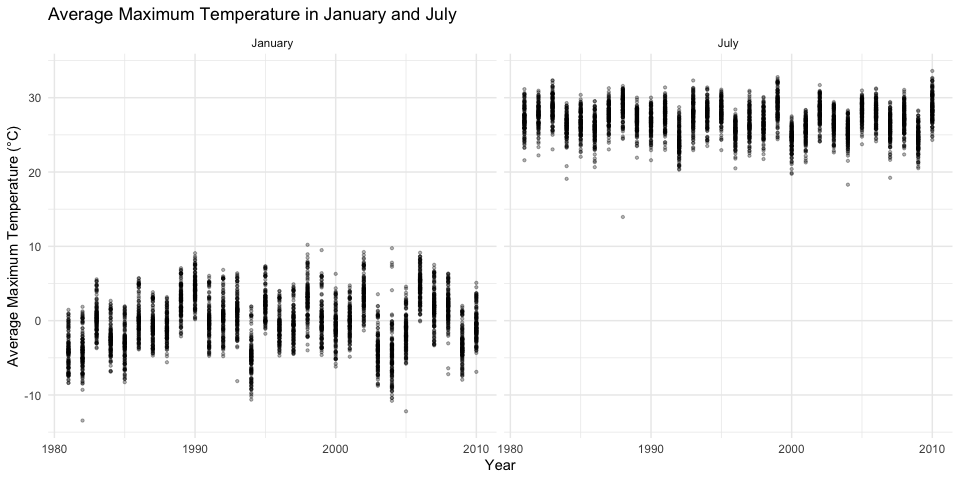
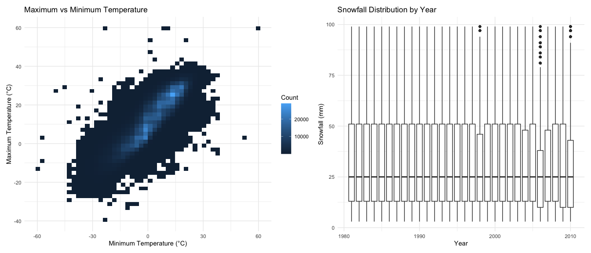
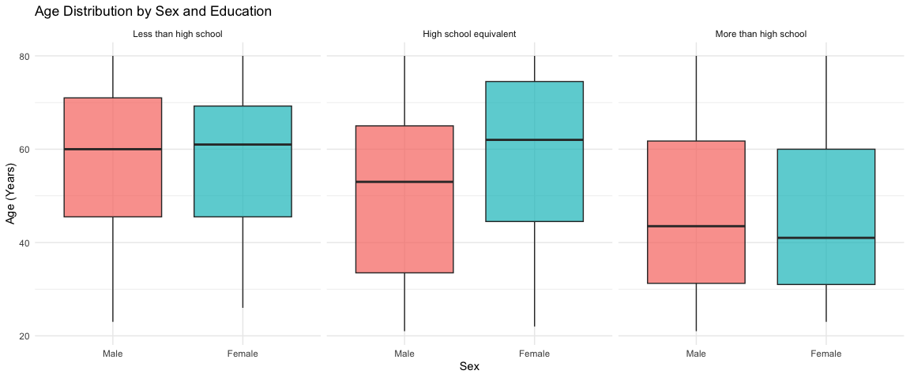
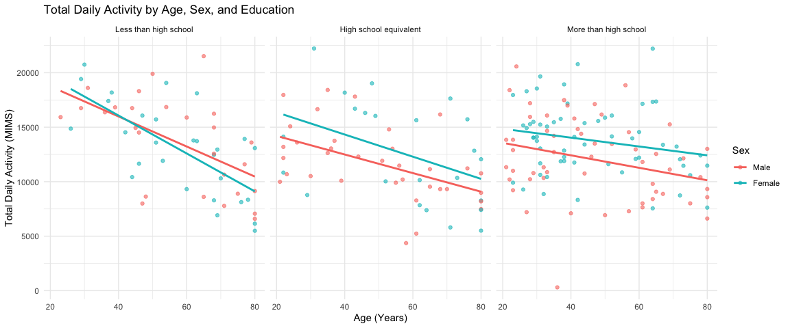
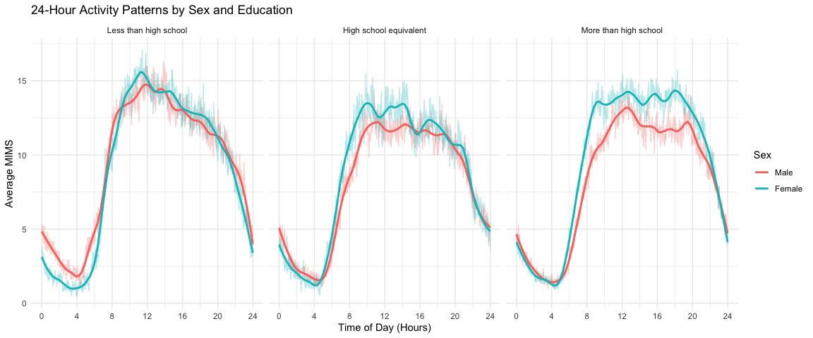
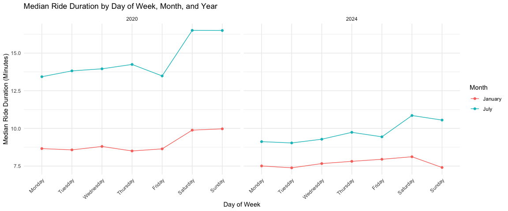
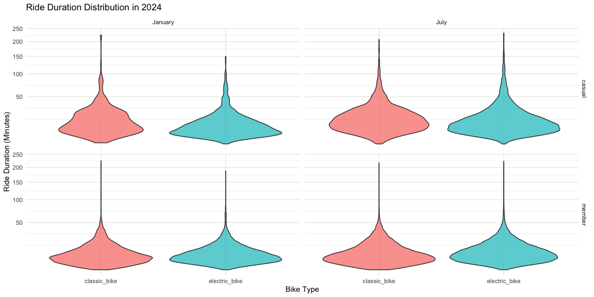

p8105_hw3_yw4817
================
Cindy Wang
2026-10-19

# Problem 1

``` r
data("ny_noaa")

ny_noaa
```

    ## # A tibble: 2,595,176 × 7
    ##    id          date        prcp  snow  snwd tmax  tmin 
    ##    <chr>       <date>     <int> <int> <int> <chr> <chr>
    ##  1 US1NYAB0001 2007-11-01    NA    NA    NA <NA>  <NA> 
    ##  2 US1NYAB0001 2007-11-02    NA    NA    NA <NA>  <NA> 
    ##  3 US1NYAB0001 2007-11-03    NA    NA    NA <NA>  <NA> 
    ##  4 US1NYAB0001 2007-11-04    NA    NA    NA <NA>  <NA> 
    ##  5 US1NYAB0001 2007-11-05    NA    NA    NA <NA>  <NA> 
    ##  6 US1NYAB0001 2007-11-06    NA    NA    NA <NA>  <NA> 
    ##  7 US1NYAB0001 2007-11-07    NA    NA    NA <NA>  <NA> 
    ##  8 US1NYAB0001 2007-11-08    NA    NA    NA <NA>  <NA> 
    ##  9 US1NYAB0001 2007-11-09    NA    NA    NA <NA>  <NA> 
    ## 10 US1NYAB0001 2007-11-10    NA    NA    NA <NA>  <NA> 
    ## # ℹ 2,595,166 more rows

``` r
glimpse(ny_noaa)
```

    ## Rows: 2,595,176
    ## Columns: 7
    ## $ id   <chr> "US1NYAB0001", "US1NYAB0001", "US1NYAB0001", "US1NYAB0001", "US1N…
    ## $ date <date> 2007-11-01, 2007-11-02, 2007-11-03, 2007-11-04, 2007-11-05, 2007…
    ## $ prcp <int> NA, NA, NA, NA, NA, NA, NA, NA, NA, NA, NA, NA, NA, NA, NA, NA, 3…
    ## $ snow <int> NA, NA, NA, NA, NA, NA, NA, NA, NA, NA, NA, NA, NA, NA, NA, NA, 3…
    ## $ snwd <int> NA, NA, NA, NA, NA, NA, NA, NA, NA, NA, NA, NA, NA, NA, NA, NA, 0…
    ## $ tmax <chr> NA, NA, NA, NA, NA, NA, NA, NA, NA, NA, NA, NA, NA, NA, NA, NA, N…
    ## $ tmin <chr> NA, NA, NA, NA, NA, NA, NA, NA, NA, NA, NA, NA, NA, NA, NA, NA, N…

``` r
nrow(ny_noaa)
```

    ## [1] 2595176

``` r
ncol(ny_noaa)
```

    ## [1] 7

``` r
n_distinct(ny_noaa$id)
```

    ## [1] 747

``` r
ny_noaa |>
  summarize(
    prcp = round(mean(is.na(prcp)) * 100, 1),
    snow = round(mean(is.na(snow)) * 100, 1),
    snwd = round(mean(is.na(snwd)) * 100, 1),
    tmax = round(mean(is.na(tmax)) * 100, 1),
    tmin = round(mean(is.na(tmin)) * 100, 1)
  )
```

    ## # A tibble: 1 × 5
    ##    prcp  snow  snwd  tmax  tmin
    ##   <dbl> <dbl> <dbl> <dbl> <dbl>
    ## 1   5.6  14.7  22.8  43.7  43.7

The NY NOAA dataset contains 2,595,176 observations and 7 variables from
747 weather stations. Each row represents a daily weather record from
one station. The variables include station ID, date, precipitation,
snowfall, snow depth, and maximum and minimum temperatures. Missing data
are relatively common, especially for maximum and minimum temperatures,
which both have 43.7% missing values. Snow depth has 22.8% missing
values, followed by 14.7% of snowfall and 5.6% of precipitation.

``` r
ny_noaa_clean =
  ny_noaa |>
  mutate(
    date = as.Date(date),
    year = lubridate::year(date),
    month = lubridate::month(date),
    day = lubridate::day(date),
    prcp = prcp / 10,
    tmax = as.numeric(tmax) / 10,
    tmin = as.numeric(tmin) / 10
  )

glimpse(ny_noaa_clean)
```

    ## Rows: 2,595,176
    ## Columns: 10
    ## $ id    <chr> "US1NYAB0001", "US1NYAB0001", "US1NYAB0001", "US1NYAB0001", "US1…
    ## $ date  <date> 2007-11-01, 2007-11-02, 2007-11-03, 2007-11-04, 2007-11-05, 200…
    ## $ prcp  <dbl> NA, NA, NA, NA, NA, NA, NA, NA, NA, NA, NA, NA, NA, NA, NA, NA, …
    ## $ snow  <int> NA, NA, NA, NA, NA, NA, NA, NA, NA, NA, NA, NA, NA, NA, NA, NA, …
    ## $ snwd  <int> NA, NA, NA, NA, NA, NA, NA, NA, NA, NA, NA, NA, NA, NA, NA, NA, …
    ## $ tmax  <dbl> NA, NA, NA, NA, NA, NA, NA, NA, NA, NA, NA, NA, NA, NA, NA, NA, …
    ## $ tmin  <dbl> NA, NA, NA, NA, NA, NA, NA, NA, NA, NA, NA, NA, NA, NA, NA, NA, …
    ## $ year  <dbl> 2007, 2007, 2007, 2007, 2007, 2007, 2007, 2007, 2007, 2007, 2007…
    ## $ month <dbl> 11, 11, 11, 11, 11, 11, 11, 11, 11, 11, 11, 11, 11, 11, 11, 11, …
    ## $ day   <int> 1, 2, 3, 4, 5, 6, 7, 8, 9, 10, 11, 12, 13, 14, 15, 16, 17, 18, 1…

``` r
ny_noaa_clean |>
  filter(!is.na(snow)) |>
  count(snow) |>
  arrange(desc(n)) |>
  head(10)
```

    ## # A tibble: 10 × 2
    ##     snow       n
    ##    <int>   <int>
    ##  1     0 2008508
    ##  2    25   31022
    ##  3    13   23095
    ##  4    51   18274
    ##  5    76   10173
    ##  6     8    9962
    ##  7     5    9748
    ##  8    38    9197
    ##  9     3    8790
    ## 10   102    6552

The most commonly observed snowfall value is 0 mm, with 2,008,508
observations, since most days have no snowfall. Other common values
include 25 mm, 13 mm, 51 mm, and 76 mm. These values are approximately
equivalent to 1, 0.5, 2, and 3 inches, which may be related to how
snowfall was originally measured and converted into millimeters.

``` r
temp_data =
  ny_noaa_clean |>
  filter(month %in% c(1, 7)) |>
  group_by(id, year, month) |>
  summarize(
    mean_tmax = mean(tmax, na.rm = TRUE),
    .groups = "drop"
  ) |>
  filter(is.finite(mean_tmax))

temp_data
```

    ## # A tibble: 8,141 × 4
    ##    id           year month mean_tmax
    ##    <chr>       <dbl> <dbl>     <dbl>
    ##  1 USC00300023  1981     1     -3.17
    ##  2 USC00300023  1981     7     28.3 
    ##  3 USC00300023  1982     1     -4.32
    ##  4 USC00300023  1982     7     27.8 
    ##  5 USC00300023  1983     1      1.11
    ##  6 USC00300023  1983     7     29.8 
    ##  7 USC00300023  1984     7     27.2 
    ##  8 USC00300023  1985     1     -1.30
    ##  9 USC00300023  1989     7     27.1 
    ## 10 USC00300023  1990     1      4.92
    ## # ℹ 8,131 more rows

``` r
temp_data |>
  mutate(
    month = factor(
      month,
      levels = c(1, 7),
      labels = c("January", "July")
    )
  ) |>
  ggplot(aes(x = year, y = mean_tmax)) +
  geom_point(alpha = 0.3, size = 0.8) +
  facet_wrap(~month) +
  labs(
    title = "Average Maximum Temperature in January and July",
    x = "Year",
    y = "Average Maximum Temperature (°C)"
  ) +
  theme_minimal()
```

<!-- -->
The average maximum temperature in July is much higher than that in
January. January temperatures show greater variation across stations and
years, while July temperatures are mostly between 20°C and 33°C. There
is no clear increasing or decreasing trend over time. A few possible
outliers can be observed, including an unusually low temperature of
around 14°C in July and some January temperatures below -10°C.

``` r
tmax_tmin_plot =
  ny_noaa_clean |>
  filter(!is.na(tmax), !is.na(tmin)) |>
  ggplot(aes(x = tmin, y = tmax)) +
  geom_bin2d(bins = 50) +
  labs(
    title = "Maximum vs Minimum Temperature",
    x = "Minimum Temperature (°C)",
    y = "Maximum Temperature (°C)",
    fill = "Count"
  ) +
  theme_minimal()
```

The plot shows a positive relationship between minimum and maximum
temperatures. As minimum temperature increases, maximum temperature also
tends to increase. Most observations are concentrated along a diagonal
pattern, while a few values fall far from the main distribution and may
be outliers.

``` r
snowfall_plot =
  ny_noaa_clean |>
  filter(snow > 0, snow < 100) |>
  ggplot(aes(x = year, y = snow, group = year)) +
  geom_boxplot() +
  labs(
    title = "Snowfall Distribution by Year",
    x = "Year",
    y = "Snowfall (mm)"
  ) +
  theme_minimal()
```

The distribution of snowfall is relatively similar across years, with a
median of around 25 mm in most years. The middle 50% of snowfall values
generally falls between approximately 13 mm and 51 mm. A few years have
higher snowfall outliers, but there is no clear long-term trend in the
distribution.

``` r
tmax_tmin_plot + snowfall_plot
```

<!-- --> The
first plot shows a positive relationship between minimum and maximum
temperatures, with most observations concentrated along a diagonal
pattern. A few observations fall far from the main distribution and may
be outliers. The second plot shows that the distribution of snowfall is
relatively similar across years. The median snowfall is around 25 mm in
most years, and the middle 50% of values generally falls between 13 mm
and 51 mm. Some years have higher snowfall outliers, but there is no
clear long-term trend.

# Problem 2

``` r
nhanes_covar =
  read_csv("data/nhanes_covar.csv", skip = 4)
```

    ## Rows: 250 Columns: 5
    ## ── Column specification ────────────────────────────────────────────────────────
    ## Delimiter: ","
    ## dbl (5): SEQN, sex, age, BMI, education
    ## 
    ## ℹ Use `spec()` to retrieve the full column specification for this data.
    ## ℹ Specify the column types or set `show_col_types = FALSE` to quiet this message.

``` r
nhanes_accel =
  read_csv("data/nhanes_accel.csv")
```

    ## Rows: 250 Columns: 1441
    ## ── Column specification ────────────────────────────────────────────────────────
    ## Delimiter: ","
    ## dbl (1441): SEQN, min1, min2, min3, min4, min5, min6, min7, min8, min9, min1...
    ## 
    ## ℹ Use `spec()` to retrieve the full column specification for this data.
    ## ℹ Specify the column types or set `show_col_types = FALSE` to quiet this message.

``` r
glimpse(nhanes_covar)
```

    ## Rows: 250
    ## Columns: 5
    ## $ SEQN      <dbl> 62161, 62164, 62169, 62174, 62177, 62178, 62180, 62184, 6218…
    ## $ sex       <dbl> 1, 2, 1, 1, 1, 1, 1, 1, 2, 2, 1, 1, 2, 1, 1, 1, 2, 1, 2, 2, …
    ## $ age       <dbl> 22, 44, 21, 80, 51, 80, 35, 26, 17, 30, 70, 17, 16, 57, 36, …
    ## $ BMI       <dbl> 23.3, 23.2, 20.1, 33.9, 20.1, 28.5, 27.9, 22.1, 22.9, 22.4, …
    ## $ education <dbl> 2, 3, 2, 3, 2, 2, 3, 2, NA, 3, 2, NA, NA, 3, 1, 3, 3, 3, 1, …

``` r
dim(nhanes_accel)
```

    ## [1]  250 1441

``` r
nhanes_accel |>
  select(SEQN, min1:min5) |>
  head()
```

    ## # A tibble: 6 × 6
    ##    SEQN  min1  min2  min3  min4   min5
    ##   <dbl> <dbl> <dbl> <dbl> <dbl>  <dbl>
    ## 1 62161 1.11  3.12  1.47  0.938 1.60  
    ## 2 62164 1.92  1.67  2.38  0.935 2.59  
    ## 3 62169 5.85  5.18  4.76  6.48  6.85  
    ## 4 62174 5.42  3.48  3.72  3.81  6.85  
    ## 5 62177 6.14  8.06  9.99  6.60  4.57  
    ## 6 62178 0.167 0.429 0.131 1.20  0.0796

``` r
nhanes_covar_clean =
  nhanes_covar |>
  filter(age >= 21) |>
  drop_na(sex, age, BMI, education) |>
  mutate(
    sex = factor(
      sex,
      levels = c(1, 2),
      labels = c("Male", "Female")
    ),
    education = factor(
      education,
      levels = c(1, 2, 3),
      labels = c(
        "Less than high school",
        "High school equivalent",
        "More than high school"
      )
    )
  )

head(nhanes_covar_clean)
```

    ## # A tibble: 6 × 5
    ##    SEQN sex      age   BMI education             
    ##   <dbl> <fct>  <dbl> <dbl> <fct>                 
    ## 1 62161 Male      22  23.3 High school equivalent
    ## 2 62164 Female    44  23.2 More than high school 
    ## 3 62169 Male      21  20.1 High school equivalent
    ## 4 62174 Male      80  33.9 More than high school 
    ## 5 62177 Male      51  20.1 High school equivalent
    ## 6 62178 Male      80  28.5 High school equivalent

``` r
nhanes_accel_long =
  nhanes_accel |>
  pivot_longer(
    cols = min1:min1440,
    names_to = "minute",
    names_prefix = "min",
    values_to = "mims"
  ) |>
  mutate(
    minute = as.numeric(minute)
  )

head(nhanes_accel_long)
```

    ## # A tibble: 6 × 3
    ##    SEQN minute  mims
    ##   <dbl>  <dbl> <dbl>
    ## 1 62161      1 1.11 
    ## 2 62161      2 3.12 
    ## 3 62161      3 1.47 
    ## 4 62161      4 0.938
    ## 5 62161      5 1.60 
    ## 6 62161      6 0.145

``` r
nhanes_df =
  inner_join(
    nhanes_covar_clean,
    nhanes_accel_long,
    by = "SEQN"
  )

nhanes_df |>
  summarize(
    participants = n_distinct(SEQN),
    observations = n()
  )
```

    ## # A tibble: 1 × 2
    ##   participants observations
    ##          <int>        <int>
    ## 1          228       328320

``` r
head(nhanes_df)
```

    ## # A tibble: 6 × 7
    ##    SEQN sex     age   BMI education              minute  mims
    ##   <dbl> <fct> <dbl> <dbl> <fct>                   <dbl> <dbl>
    ## 1 62161 Male     22  23.3 High school equivalent      1 1.11 
    ## 2 62161 Male     22  23.3 High school equivalent      2 3.12 
    ## 3 62161 Male     22  23.3 High school equivalent      3 1.47 
    ## 4 62161 Male     22  23.3 High school equivalent      4 0.938
    ## 5 62161 Male     22  23.3 High school equivalent      5 1.60 
    ## 6 62161 Male     22  23.3 High school equivalent      6 0.145

``` r
nhanes_covar_clean |>
  count(education, sex) |>
  pivot_wider(
    names_from = sex,
    values_from = n,
    values_fill = 0
  ) |>
  knitr::kable(
    caption = "Number of Participants by Sex and Education"
  )
```

| education              | Male | Female |
|:-----------------------|-----:|-------:|
| Less than high school  |   27 |     28 |
| High school equivalent |   35 |     23 |
| More than high school  |   56 |     59 |

Number of Participants by Sex and Education

There are 118 men and 110 women in the cleaned dataset. Most
participants have more than a high school education, with 56 men and 59
women in this category. The number of men and women is relatively
similar in the other categories, except for the high school equivalent
group, which has more men.

``` r
nhanes_covar_clean |>
  ggplot(aes(x = sex, y = age, fill = sex)) +
  geom_boxplot(alpha = 0.7) +
  facet_wrap(~education) +
  labs(
    title = "Age Distribution by Sex and Education",
    x = "Sex",
    y = "Age (Years)"
  ) +
  theme_minimal() +
  theme(legend.position = "none")
```

<!-- -->
The age distributions differ across education levels. Participants with
more than a high school education tend to be younger, with median ages
around 40–45 years. In the high school equivalent group, women have a
higher median age than men, while the age distributions are relatively
similar for men and women with less than a high school education.

``` r
nhanes_total =
  nhanes_df |>
  group_by(SEQN, sex, age, BMI, education) |>
  summarize(
    total_activity = sum(mims, na.rm = TRUE),
    .groups = "drop"
  )

head(nhanes_total)
```

    ## # A tibble: 6 × 6
    ##    SEQN sex      age   BMI education              total_activity
    ##   <dbl> <fct>  <dbl> <dbl> <fct>                           <dbl>
    ## 1 62161 Male      22  23.3 High school equivalent         13194.
    ## 2 62164 Female    44  23.2 More than high school          13411.
    ## 3 62169 Male      21  20.1 High school equivalent          9991.
    ## 4 62174 Male      80  33.9 More than high school           8579.
    ## 5 62177 Male      51  20.1 High school equivalent         11918.
    ## 6 62178 Male      80  28.5 High school equivalent          7489.

``` r
nhanes_total |>
  ggplot(aes(x = age, y = total_activity, color = sex)) +
  geom_point(alpha = 0.6) +
  geom_smooth(method = "lm", se = FALSE) +
  facet_wrap(~education) +
  labs(
    title = "Total Daily Activity by Age, Sex, and Education",
    x = "Age (Years)",
    y = "Total Daily Activity (MIMS)",
    color = "Sex"
  ) +
  theme_minimal()
```

    ## `geom_smooth()` using formula = 'y ~ x'

<!-- -->
Total daily activity tends to decrease with age across all three
education groups. This decline is more noticeable among participants
with less than a high school education, while those with more than a
high school education show a relatively smaller decline. Women generally
have higher fitted activity levels than men in the high school
equivalent and more than high school groups. However, there is
considerable variation in total activity among participants of similar
ages.

``` r
nhanes_time =
  nhanes_df |>
  group_by(education, sex, minute) |>
  summarize(
    mean_mims = mean(mims, na.rm = TRUE),
    .groups = "drop"
  ) |>
  mutate(
    hour = (minute - 1) / 60
  )

head(nhanes_time)
```

    ## # A tibble: 6 × 5
    ##   education             sex   minute mean_mims   hour
    ##   <fct>                 <fct>  <dbl>     <dbl>  <dbl>
    ## 1 Less than high school Male       1      5.31 0     
    ## 2 Less than high school Male       2      5.06 0.0167
    ## 3 Less than high school Male       3      4.72 0.0333
    ## 4 Less than high school Male       4      5.02 0.05  
    ## 5 Less than high school Male       5      4.55 0.0667
    ## 6 Less than high school Male       6      4.88 0.0833

``` r
nhanes_time |>
  ggplot(aes(x = hour, y = mean_mims, color = sex)) +
  geom_line(alpha = 0.3) +
  geom_smooth(method = "loess", span = 0.15, se = FALSE) +
  facet_wrap(~education) +
  scale_x_continuous(breaks = seq(0, 24, by = 4)) +
  labs(
    title = "24-Hour Activity Patterns by Sex and Education",
    x = "Time of Day (Hours)",
    y = "Average MIMS",
    color = "Sex"
  ) +
  theme_minimal()
```

    ## `geom_smooth()` using formula = 'y ~ x'

<!-- -->
The three education groups show similar daily activity patterns. Average
activity is lowest during the early morning hours, increases rapidly
after around 6 AM, and remains relatively high during the daytime before
decreasing in the evening. Men and women have similar activity patterns
in the less than high school group. In the other two education groups,
women generally have higher average activity during the day, especially
among participants with more than a high school education.

# Problem 3

``` r
list.files("data", recursive = TRUE)
```

    ##  [1] "Jan 2020 Citi.csv"      "Jan 2020 Citi.csv.zip"  "Jan 2024 Citi.csv"     
    ##  [4] "Jan 2024 Citi.csv.zip"  "July 2020 Citi.csv"     "July 2020 Citi.csv.zip"
    ##  [7] "July 2024 Citi.csv"     "July 2024 Citi.csv.zip" "nhanes_accel.csv"      
    ## [10] "nhanes_covar.csv"

``` r
citi_jan_2020 =
  read_csv("data/Jan 2020 Citi.csv")
```

    ## Rows: 12420 Columns: 7
    ## ── Column specification ────────────────────────────────────────────────────────
    ## Delimiter: ","
    ## chr (6): ride_id, rideable_type, weekdays, start_station_name, end_station_n...
    ## dbl (1): duration
    ## 
    ## ℹ Use `spec()` to retrieve the full column specification for this data.
    ## ℹ Specify the column types or set `show_col_types = FALSE` to quiet this message.

``` r
citi_july_2020 =
  read_csv("data/July 2020 Citi.csv")
```

    ## Rows: 21048 Columns: 7
    ## ── Column specification ────────────────────────────────────────────────────────
    ## Delimiter: ","
    ## chr (6): ride_id, rideable_type, weekdays, start_station_name, end_station_n...
    ## dbl (1): duration
    ## 
    ## ℹ Use `spec()` to retrieve the full column specification for this data.
    ## ℹ Specify the column types or set `show_col_types = FALSE` to quiet this message.

``` r
citi_jan_2024 =
  read_csv("data/Jan 2024 Citi.csv")
```

    ## Rows: 18861 Columns: 7
    ## ── Column specification ────────────────────────────────────────────────────────
    ## Delimiter: ","
    ## chr (6): ride_id, rideable_type, weekdays, start_station_name, end_station_n...
    ## dbl (1): duration
    ## 
    ## ℹ Use `spec()` to retrieve the full column specification for this data.
    ## ℹ Specify the column types or set `show_col_types = FALSE` to quiet this message.

``` r
citi_july_2024 =
  read_csv("data/July 2024 Citi.csv")
```

    ## Rows: 47156 Columns: 7
    ## ── Column specification ────────────────────────────────────────────────────────
    ## Delimiter: ","
    ## chr (6): ride_id, rideable_type, weekdays, start_station_name, end_station_n...
    ## dbl (1): duration
    ## 
    ## ℹ Use `spec()` to retrieve the full column specification for this data.
    ## ℹ Specify the column types or set `show_col_types = FALSE` to quiet this message.

``` r
glimpse(citi_jan_2020)
```

    ## Rows: 12,420
    ## Columns: 7
    ## $ ride_id            <chr> "4BE06CB33B037044", "26886E034974493B", "24DC56060E…
    ## $ rideable_type      <chr> "classic_bike", "classic_bike", "classic_bike", "cl…
    ## $ weekdays           <chr> "Tuesday", "Wednesday", "Friday", "Sunday", "Friday…
    ## $ duration           <dbl> 15.333267, 5.309467, 9.691800, 6.996183, 2.849500, …
    ## $ start_station_name <chr> "Columbus Ave & W 95 St", "2 Ave & E 96 St", "Colum…
    ## $ end_station_name   <chr> "E 53 St & Madison Ave", "1 Ave & E 110 St", "Grand…
    ## $ member_casual      <chr> "member", "member", "member", "member", "member", "…

``` r
glimpse(citi_jan_2024)
```

    ## Rows: 18,861
    ## Columns: 7
    ## $ ride_id            <chr> "644A0105ACA27B15", "A5A8C0AD18EDA2C0", "B392CE3496…
    ## $ rideable_type      <chr> "electric_bike", "electric_bike", "electric_bike", …
    ## $ weekdays           <chr> "Wednesday", "Wednesday", "Tuesday", "Wednesday", "…
    ## $ duration           <dbl> 16.472933, 6.294983, 6.119750, 10.875667, 8.416267,…
    ## $ start_station_name <chr> "Lafayette St & Jersey St", "Clinton St & Tillary S…
    ## $ end_station_name   <chr> "W 50 St & 9 Ave", "Duffield St & Willoughby St", "…
    ## $ member_casual      <chr> "member", "member", "member", "member", "member", "…

``` r
nrow(citi_jan_2020)
```

    ## [1] 12420

``` r
nrow(citi_july_2020)
```

    ## [1] 21048

``` r
nrow(citi_jan_2024)
```

    ## [1] 18861

``` r
nrow(citi_july_2024)
```

    ## [1] 47156

``` r
citi_df =
  bind_rows(
    citi_jan_2020 |> mutate(year = 2020, month = "January"),
    citi_july_2020 |> mutate(year = 2020, month = "July"),
    citi_jan_2024 |> mutate(year = 2024, month = "January"),
    citi_july_2024 |> mutate(year = 2024, month = "July")
  ) |>
  mutate(
    month = factor(month, levels = c("January", "July")),
    weekdays = factor(
      weekdays,
      levels = c(
        "Monday", "Tuesday", "Wednesday", "Thursday",
        "Friday", "Saturday", "Sunday"
      )
    ),
    member_casual = factor(
      member_casual,
      levels = c("casual", "member")
    ),
    rideable_type = factor(rideable_type)
  )

glimpse(citi_df)
```

    ## Rows: 99,485
    ## Columns: 9
    ## $ ride_id            <chr> "4BE06CB33B037044", "26886E034974493B", "24DC56060E…
    ## $ rideable_type      <fct> classic_bike, classic_bike, classic_bike, classic_b…
    ## $ weekdays           <fct> Tuesday, Wednesday, Friday, Sunday, Friday, Sunday,…
    ## $ duration           <dbl> 15.333267, 5.309467, 9.691800, 6.996183, 2.849500, …
    ## $ start_station_name <chr> "Columbus Ave & W 95 St", "2 Ave & E 96 St", "Colum…
    ## $ end_station_name   <chr> "E 53 St & Madison Ave", "1 Ave & E 110 St", "Grand…
    ## $ member_casual      <fct> member, member, member, member, member, member, mem…
    ## $ year               <dbl> 2020, 2020, 2020, 2020, 2020, 2020, 2020, 2020, 202…
    ## $ month              <fct> January, January, January, January, January, Januar…

``` r
citi_df |>
  count(year, month)
```

    ## # A tibble: 4 × 3
    ##    year month       n
    ##   <dbl> <fct>   <int>
    ## 1  2020 January 12420
    ## 2  2020 July    21048
    ## 3  2024 January 18861
    ## 4  2024 July    47156

``` r
citi_df |>
  count(member_casual)
```

    ## # A tibble: 2 × 2
    ##   member_casual     n
    ##   <fct>         <int>
    ## 1 casual        19623
    ## 2 member        79862

``` r
citi_df |>
  count(rideable_type)
```

    ## # A tibble: 2 × 2
    ##   rideable_type     n
    ##   <fct>         <int>
    ## 1 classic_bike  55536
    ## 2 electric_bike 43949

``` r
citi_df |>
  summarize(
    missing_duration = sum(is.na(duration)),
    missing_station = sum(is.na(start_station_name)),
    missing_membership = sum(is.na(member_casual))
  )
```

    ## # A tibble: 1 × 3
    ##   missing_duration missing_station missing_membership
    ##              <int>           <int>              <int>
    ## 1                0              43                  0

The Citi Bike dataset contains 99,485 rides from January and July of
2020 and 2024. I combined the four datasets and added year and month
variables. The resulting dataset has 9 variables, including ride
duration, bike type, starting and ending stations, day of the week, and
membership status. There are 79,862 rides made by members and 19,623 by
casual riders. There are 43 missing values for starting station names,
while duration and membership status have no missing values.

``` r
citi_df |>
  count(year, month, member_casual) |>
  pivot_wider(
    names_from = member_casual,
    values_from = n,
    values_fill = 0
  ) |>
  arrange(year, month) |>
  knitr::kable(
    caption = "Number of Rides by Year, Month, and Membership"
  )
```

| year | month   | casual | member |
|-----:|:--------|-------:|-------:|
| 2020 | January |    984 |  11436 |
| 2020 | July    |   5637 |  15411 |
| 2024 | January |   2108 |  16753 |
| 2024 | July    |  10894 |  36262 |

Number of Rides by Year, Month, and Membership

Members had more rides than casual riders in all four months. The number
of rides was higher in July than in January for both years, which may be
related to warmer weather and more outdoor activities during summer.
Ride counts were also higher in 2024 than in 2020 for both months.
Casual riders accounted for a larger proportion of rides in July, while
members made up most of the rides in January.

``` r
citi_df |>
  filter(
    year == 2024,
    month == "July",
    !is.na(start_station_name)
  ) |>
  count(start_station_name) |>
  arrange(desc(n)) |>
  head(5) |>
  knitr::kable(
    col.names = c("Starting Station", "Number of Rides"),
    caption = "Top 5 Starting Stations in July 2024"
  )
```

| Starting Station         | Number of Rides |
|:-------------------------|----------------:|
| Pier 61 at Chelsea Piers |             163 |
| University Pl & E 14 St  |             155 |
| W 21 St & 6 Ave          |             152 |
| West St & Chambers St    |             150 |
| W 31 St & 7 Ave          |             146 |

Top 5 Starting Stations in July 2024

In July 2024, Pier 61 at Chelsea Piers was the most popular starting
station in the sample, with 163 rides, followed by University Pl & E 14
St with 155 rides. The five most popular stations had relatively similar
ride counts, ranging from 146 to 163.

``` r
citi_duration =
  citi_df |>
  group_by(year, month, weekdays) |>
  summarize(
    median_duration = median(duration, na.rm = TRUE),
    .groups = "drop"
  )

head(citi_duration)
```

    ## # A tibble: 6 × 4
    ##    year month   weekdays  median_duration
    ##   <dbl> <fct>   <fct>               <dbl>
    ## 1  2020 January Monday               8.66
    ## 2  2020 January Tuesday              8.57
    ## 3  2020 January Wednesday            8.80
    ## 4  2020 January Thursday             8.50
    ## 5  2020 January Friday               8.64
    ## 6  2020 January Saturday             9.88

``` r
citi_duration |>
  ggplot(
    aes(
      x = weekdays,
      y = median_duration,
      color = month,
      group = month
    )
  ) +
  geom_point() +
  geom_line() +
  facet_wrap(~year) +
  labs(
    title = "Median Ride Duration by Day of Week, Month, and Year",
    x = "Day of Week",
    y = "Median Ride Duration (Minutes)",
    color = "Month"
  ) +
  theme_minimal() +
  theme(
    axis.text.x = element_text(angle = 45, hjust = 1)
  )
```

<!-- -->
Median ride duration was higher in July than in January in both years.
Rides also tended to be longer on weekends, especially in July 2020,
when the median duration reached around 16.5 minutes on Saturday and
Sunday. Compared with 2020, median ride duration was generally shorter
in 2024 for both months. The difference between weekdays and weekends
was also less noticeable in 2024.

``` r
citi_df |>
  filter(year == 2024) |>
  ggplot(aes(x = rideable_type, y = duration, fill = rideable_type)) +
  geom_violin(alpha = 0.7) +
  facet_grid(member_casual ~ month) +
  scale_y_sqrt() +
  labs(
    title = "Ride Duration Distribution in 2024",
    x = "Bike Type",
    y = "Ride Duration (Minutes)",
    fill = "Bike Type"
  ) +
  theme_minimal() +
  theme(legend.position = "none")
```

<!-- -->
The plot shows that casual riders generally have longer ride duration
than members, with a wider distribution of values. Among casual riders,
classic bikes tend to have longer rides than electric bikes, while the
difference is less noticeable among members. Ride durations also vary
between January and July, although the distributions overlap
considerably. Most rides are relatively short, with a smaller number of
rides lasting much longer.
